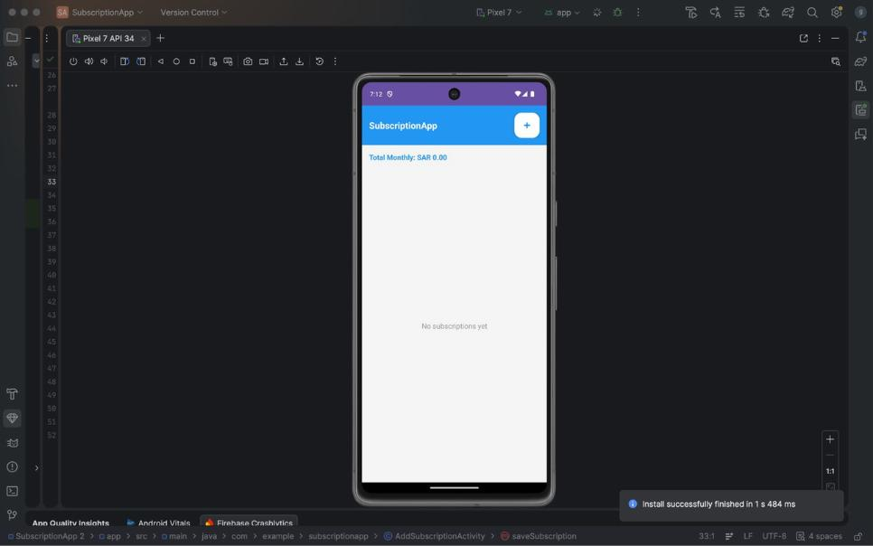
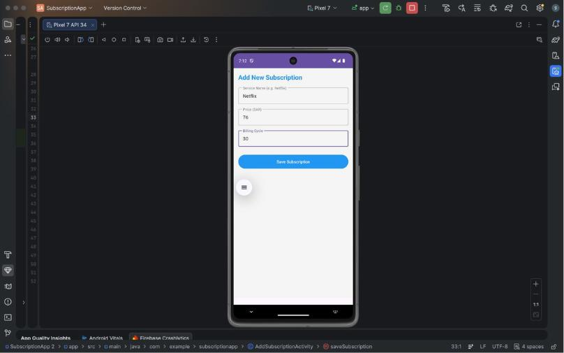
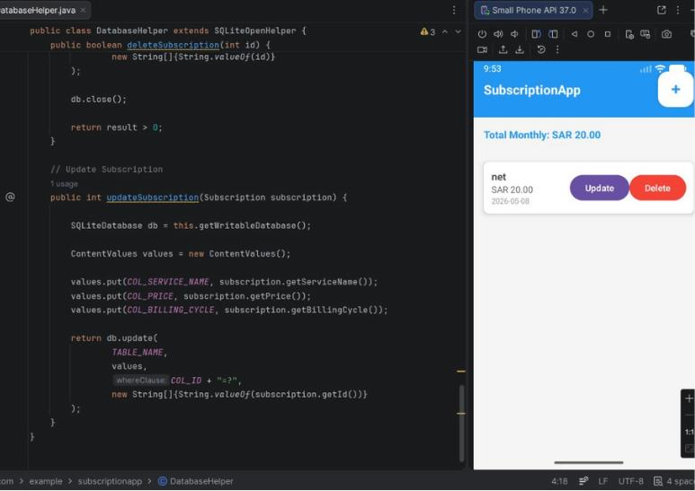

# SubscriptionApp

An Android application developed in **Java** using **Android Studio** and **SQLite** for tracking and managing recurring monthly subscriptions with automatic monthly spending calculation in **SAR**.

> [!NOTE]
> All subscription records are stored locally on the device using SQLite (`SQLiteOpenHelper`), allowing full offline access and instant CRUD operations.

---

## Key Features

- **Add Subscriptions:** Enter service name, price in SAR, and billing cycle in days.
- **Browse & Track:** View active subscriptions in a smooth scrollable list powered by `RecyclerView`.
- **Update & Delete:** Edit existing subscription details or remove unused subscriptions anytime.
- **Automatic Monthly Total:** View total monthly spending calculated and displayed directly at the top of the home screen.

---

## Screenshots

| Home Empty State | Add Subscription Screen | Subscriptions CRUD |
| :---: | :---: | :---: |
|  |  |  |

---

## Tech Stack & Project Structure

- **Core Stack:** Java, Android Studio, XML Layouts, RecyclerView, SQLite (`SQLiteOpenHelper`)
- `app/src/main/java/com/example/subscriptionapp/DatabaseHelper.java`: Manages SQLite database creation and CRUD operations (`insert`, `read`, `update`, `delete`).
- `app/src/main/java/com/example/subscriptionapp/AddSubscriptionActivity.java`: Handles adding new subscription entries.
- `app/src/main/res/layout/`: Contains XML layout files for activities and list items.

<strong>Click to view how to run the project locally</strong>

1. Clone or download the repository.
2. Open the project folder in **Android Studio**.
3. Allow Gradle sync to finish.
4. Run the app on an Android emulator or physical device.

<strong>Click to view planned improvements</strong>

- Renewal reminder notifications before billing dates
- Dark mode support
- Cloud backup and synchronization

